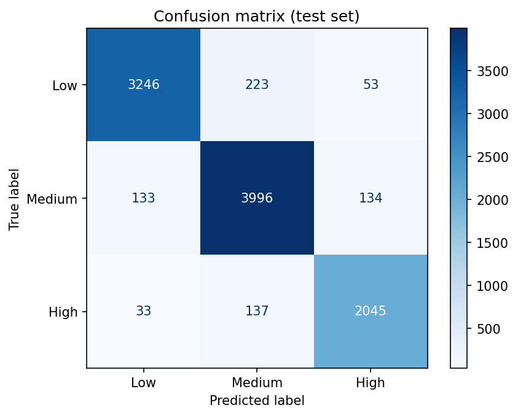

# AI Document Risk & Compliance Classifier

Classifies contract clauses into **Low / Medium / High** risk, explains each prediction, and sends low-confidence cases to **manual review**. Includes a Streamlit dashboard for uploading documents (PDF, DOCX, TXT) or pasting text.

## How it works
1. **Data:** LEDGAR (LexGLUE) — about 80,000 real contract provisions from SEC filings, each labeled with one of 100 clause types.
2. **Risk policy:** LEDGAR has no risk labels, so I mapped the 100 clause types to risk levels (26 High, 45 Medium, 29 Low) based on legal and financial exposure. High includes indemnification, termination, taxes, arbitration and IP; Low covers boilerplate such as headings, notices and counterparts.
3. **Model:** TF-IDF (1–2 word n-grams) + Logistic Regression.
4. **Explainability:** top contributing terms per prediction and the most similar training clauses.
5. **Confidence threshold (0.80):** predictions below it are flagged for manual review.
6. **Dashboard:** document-level risk (highest clause risk), flagged-document table, clause-level detail, and model performance.

## Results (test set, 10,000 clauses)
| | Accuracy | Share of clauses |
|---|---|---|
| All clauses | 92.9% | 100% |
| Auto-labeled (confidence ≥ 0.80) | 97.0% | 85.8% |
| Sent to manual review | — | 14.2% |

Class-wise F1 is 0.92–0.94 on all clauses and 0.97 on auto-labeled ones. A truly High clause was predicted as Low only 33 times out of 2,215 (about 1.5%).




## Run locally
```bash
pip install -r requirements.txt
streamlit run app.py
```
Requires `models/risk_model.joblib` (included) and scikit-learn 1.6.1.

## Project structure
- `notebooks/` — data exploration, risk mapping, training and evaluation
- `src/text_extraction.py` — PDF/DOCX/TXT reading and clause splitting
- `src/predict.py` — prediction, confidence, explanations
- `app.py` — Streamlit dashboard

## Limitations
- Risk levels come from my clause-type mapping, not from legal experts, so they are a design choice, not ground truth.
- Labels in LEDGAR are noisy: some clauses blend several types, and the model can be confidently wrong, which a confidence threshold cannot catch.
- Trained on single clauses, so whole documents are split into clauses heuristically. Scanned (image-only) PDFs are not supported.
- This is a decision-support tool and not legal advice.